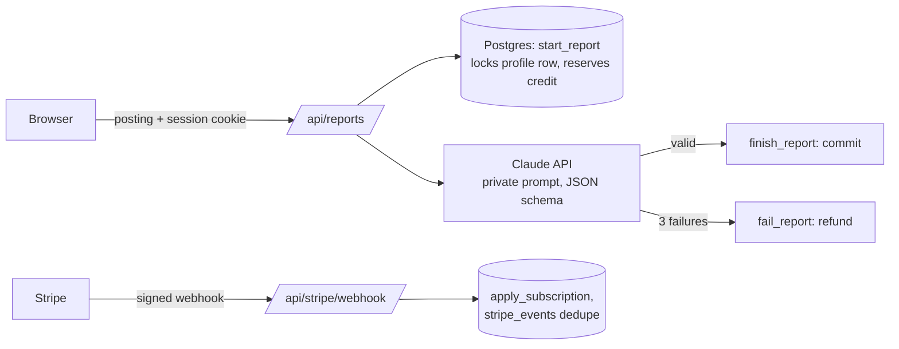

# PrepDesk

Paste a job posting, get an interview-prep report. A small paid web app built as a portfolio demo: sign-in, a monthly credit ledger, Stripe subscriptions, and an AI call whose prompt and API key never leave the server.

**Live demo:** <VERCEL_URL> (Stripe test mode, card 4242 4242 4242 4242)

> Standalone demo project. Not affiliated with any company or client.

## Stack

Next.js (App Router, TypeScript) on Vercel · Supabase (Postgres, Auth, RLS) · Stripe (Checkout, Customer Portal, webhooks) · Claude API · zod · Vitest

## Architecture



## Credit ledger

- `credit_ledger` is append-only: `reserve` (−1), `commit` (0), `refund` (+1). Balance is computed from it, never stored.
- `start_report` locks the user's profile row (`SELECT … FOR UPDATE`), checks the balance and reserves in one transaction.
- `finish_report` / `fail_report` only act on a `pending` report, and a unique `(report_id, kind)` constraint blocks double commits or refunds.
- Reports stuck in `pending` for 10 minutes are refunded automatically.

Concurrency test (`npm run ledger:test`, against a real Supabase project):

```
10 parallel reserves with 3 credits: 3 succeeded, 7 refused
finish twice: true, false; fail after finish: false
fail twice: true, false
usage after one refund: used 2, remaining 1
Ledger concurrency test passed
```

## Keeping the prompt and keys private

- The prompt lives in `lib/prompts/report.ts`, which imports `server-only`: importing it from browser code fails the build.
- API keys are read only on the server from environment variables; `.env.local` is git-ignored.
- The model must return JSON matching a fixed schema; invalid output is retried up to 3 times, then the credit is refunded.
- Errors shown to users are generic; logs record IDs and timings only.
- Row Level Security: users can read only their own rows; all writes go through SQL functions run by the server.

## Stripe

Checkout creates the subscription; webhooks are the only thing that change a plan. Each event ID is processed once; replays return 200 without side effects. An event for an unknown customer returns 500 so Stripe retries.

## Run locally

```bash
cp .env.example .env.local   # fill in Supabase, Anthropic and Stripe test keys
npm install
npx supabase db push         # or run supabase/migrations/0001_init.sql in the SQL editor
npm run dev
stripe listen --forward-to localhost:3000/api/stripe/webhook
```

Checks: `npm run lint && npm run typecheck && npm test`

## Manual checklist

1. Sign in with an email link → lands on New report.
2. Generate a report → report page with 5 sections; History lists it.
3. Generate until the Free limit → "You've used 3 of 3 reports this month" with an upgrade link.
4. Upgrade with 4242 4242 4242 4242 → success page shows Pro is active; limit becomes 30.
5. Manage billing → Stripe Customer Portal opens; cancel at period end keeps Pro.
6. Open another user's report URL → 404.
